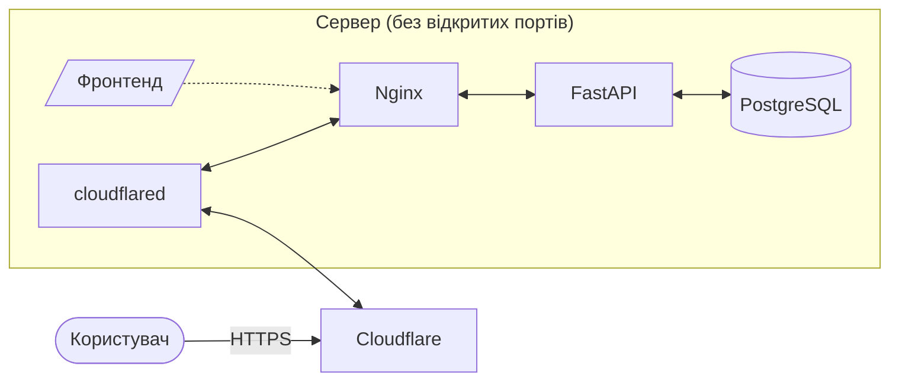

# ДійТут

Вебзастосунок, що допомагає волонтерам знаходити проєкти, а організаціям — людей.

## Технології

- **Бекенд:** Python, FastAPI, SQLAlchemy (async), Alembic, uv, ruff
- **Фронтенд:** React, TypeScript, Vite, Oxlint, Prettier
- **Інфраструктура:** Docker Compose, PostgreSQL, nginx, Cloudflare Tunnel

Точні версії зафіксовані у файлах залежностей і образах, а Dependabot пропонує їх оновлення окремими PR.

## Документація

- [Бекенд](backend/README.md) — структура коду, залежності, моделі й міграції, перевірки якості
- [Фронтенд](frontend/README.md) — запуск, скрипти, звернення до API, редактор

## Архітектура



- Сервер не має відкритих портів: `cloudflared` сам підключається до Cloudflare, і запити приходять назад через цей тунель.
- nginx роздає зібраний фронтенд і пересилає запити до API на бекенд, обмежуючи частоту запитів з одного IP.
- Сайт і API живуть на одному домені: фронтенд у корені, API під префіксом `/api`.
- База даних знаходиться в ізольованій мережі без доступу до інтернету; до неї має доступ лише бекенд.

## Організація репозиторію

Це монорепозиторій з трьох частин:

- **фронтенд** і **бекенд** — кожен у власній теці, самодостатній: зі своїми залежностями, образом Docker і документацією;
- **інфраструктура** — у корені: опис усього стеку для Docker Compose, конфігурація nginx, спільні налаштування репозиторію.

Опис стеку розділений на дві частини: основна відповідає продакшну, а доповнення для локальної розробки (відкриті на `127.0.0.1` порти, автоперезавантаження коду, вимкнений тунель) підхоплюється автоматично лише на машинах розробників.

## Домовленості

- **Кінці рядків** у репозиторії — LF незалежно від ОС; відступи й кодування задані спільним налаштуванням редактора.

## Що потрібно встановити

- **Git**
- **Docker** з Docker Compose.
- **Node.js** — лише для роботи над фронтендом на власній машині. Без нього фронтенд можна запускати в контейнері.

Python, uv чи PostgreSQL на свою машину ставити не обов'язково: бекенд повністю працює в контейнерах.

**Windows:** Docker Desktop з WSL2. Клонуйте репозиторій усередину файлової системи WSL, а не на диск Windows, інакше автоперезавантаження коду працюватиме повільно. Те саме стосується віртуальних машин: код має лежати у файловій системі VM, а не в спільній теці.

## Швидкий старт

```bash
cp .env.example .env    # заповнити пароль БД
docker compose up -d --build
docker compose exec api alembic upgrade head
```

Після цього локально доступні:

- бекенд напряму на порту **8000**, з автодокументацією API за адресою `/api/docs`;
- весь продакшн-ланцюжок через nginx на порту **8080**;
- PostgreSQL на порту **5432**.

Усі порти відкриті лише на `127.0.0.1`. Зміни в коді бекенду підхоплюються без перезапуску. Фронтенд у режимі розробки запускається окремо — див. [документацію фронтенду](frontend/README.md).

Зупинка стеку дані БД не видаляє. Вони зникають лише при явному видаленні томів, тож робіть це свідомо.

## Продакшн

- На сервері застосовується лише основний опис стеку, без доповнення для розробки.
- Файл оточення копіюється на сервер вручну і закривається від інших користувачів.
- Міграції не запускаються автоматично при старті контейнера, тож вручну.