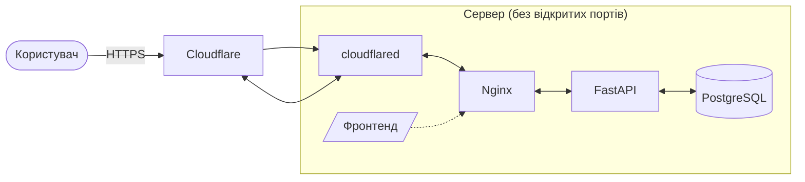

# diytut

## Як працює сервер (спрощено)


Сервер не має відкритих портів: `cloudflared` сам підключається до Cloudflare, і запити приходять назад через цей тунель. PostgreSQL знаходиться в ізольованій мережі без доступу до інтернету, до неї має доступ лише FastAPI.

## Розгортання
1. Заповнити `.env` за прикладом:
```bash
cp .env.example .env
```
2. Запустити контейнери:
```bash
docker compose up -d
```

## Розробка
```bash
uv sync
```